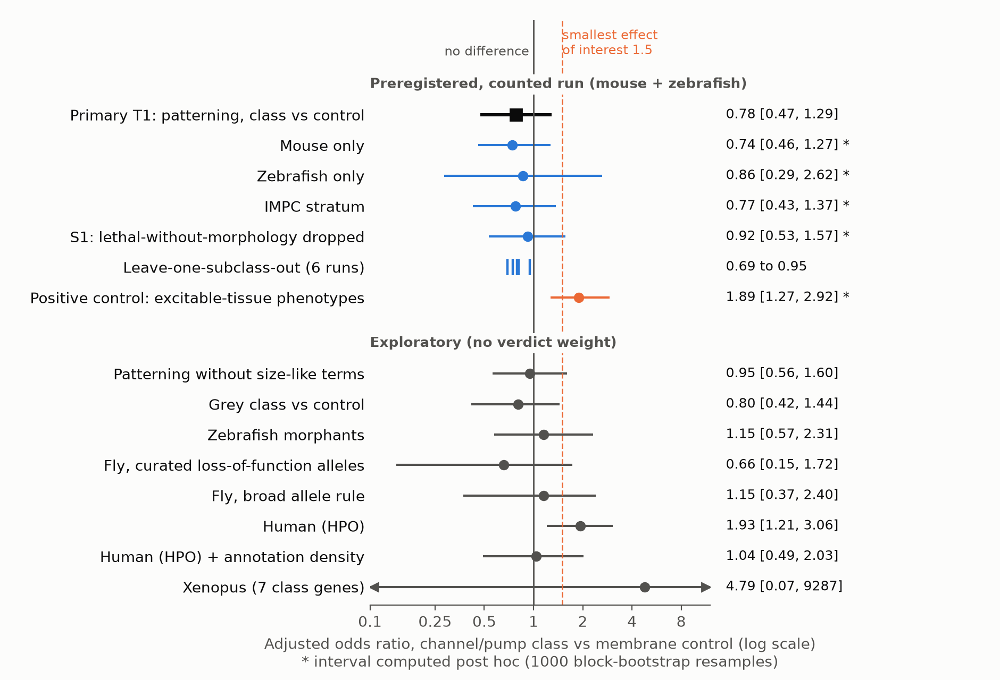
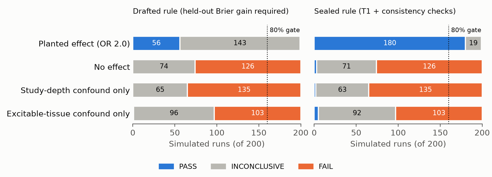

> **DRAFT — not submitted; for author review**

# Ion channel and pump genes are not enriched for morphological patterning phenotypes on loss of function: a preregistered cross-species test

**Manav Davis**

Affiliation: [to fill]

Draft date: 2026-11-10. Repository: https://github.com/MDavis3/bioelectric-bench

---

## Abstract

Bioelectric accounts of development hold that membrane voltage patterns instruct anatomy. One cheap, class-level prediction of a strong version of this claim is that genes encoding ion channels and pumps should, when lost, produce patterning defects more often than comparable membrane proteins. We tested this in public mouse (MGI, IMPC) and zebrafish (ZFIN) loss-of-function records, with the endpoint, gene classes, covariates, code, decision rule and power simulation hashed and timestamped in a public repository before any outcome was seen by class. Among 394 channel/pump gene-by-species units and 972 matched multi-pass membrane controls, 11.4% and 11.9% had a recorded craniofacial, limb/fin, axial, somite, notochord, neural tube or left-right defect. The adjusted odds ratio was 0.78 (95% block-bootstrap interval 0.47 to 1.29), which excludes the preregistered smallest effect of interest of 1.5. A positive control on excitable-tissue phenotypes was detected in the same units (odds ratio 1.89, one-sided p = 0.001). Point estimates were below 1 in each species, in the standardised IMPC stratum and in every leave-one-subclass-out run. The result removes one line of support for the idea that channels as a class are privileged for patterning. It does not test voltage state, gain-of-function alleles, pharmacology or regeneration. We also report that the decision rule was revised before unblinding because the original rule lacked power, and that an apparent human enrichment was not robust to adjustment for annotation density.

## 1. Introduction

Endogenous voltage gradients and ion flows have been proposed to act as instructive signals for large-scale anatomy, alongside biochemical and mechanical cues (Levin 2014, 2021; Bates 2015). The evidence is mostly perturbational: misexpressed channels, ionophores and channel-acting drugs alter eye, head, axis and appendage outcomes in *Xenopus* and planaria (Pai et al. 2012; Beane et al. 2011), and specific channel mutations cause patterning phenotypes, such as Kir2.1 in Andersen-Tawil syndrome and its mouse and fly counterparts (Plaster et al. 2001; Dahal et al. 2012), or potassium channel and connexin alleles that change zebrafish fin size and pigment stripes (Perathoner et al. 2014; Iwashita et al. 2006; Watanabe et al. 2006).

Individual examples do not show that the class is special. A version of the bioelectric claim that says the machinery setting membrane potential is, as a class, unusually important for pattern makes a testable prediction: across the genome-scale knockout record, channel and pump genes should show patterning defects more often than other integral membrane proteins studied in the same way. The data already exist, and the main failure mode (channels cause seizures, arrhythmia and deafness) can be designed out and turned into a positive control.

The test is narrow. It concerns germline loss of single genes, recorded phenotypes, and gene class as a distant proxy for voltage. A null cannot speak to gain-of-function, pharmacological shifts in membrane potential, regeneration, or a code that is robust to losing any one channel. The plan stated before the result that a PASS would not be proof of a bioelectric code.

## 2. Methods

**Preregistration and sources.** The plan is `plans/pivot_db_v1.md` (sealed copy `sealed/db_prereg_v1__c9b6784d688b.md`). All files were downloaded on 2026-11-10 (hashes in `data/raw_db_manifest.json`): MGI genotype-phenotype and allele reports; IMPC calls and tested-gene list from the IMPC Solr API; ZFIN phenotype, fish composition and environment files; Alliance orthology; HGNC gene groups; Guide to Pharmacology 2026.3.1; GO annotations (GAF 2026-05-20/21); Monarch knowledge graph expression edges; and the MP (2026-10-29), ZFA (2026-07-16), PATO (2026-10-01), GO (2026-07-26) and Uberon (2026-11-05) ontologies. MGI, IMPC, ZFIN and Alliance files carry no release stamp beyond the download date.

**Units and eligibility.** The unit is gene x species (mouse, zebrafish). A unit exists only if the gene has at least one eligible record, normal findings included; an unstudied gene is not a negative. Mouse: MGI single-gene genotypes in which every allele is annotated "Null/knockout", with a PMID, no transgene or recombinase allele; plus IMPC lines that went through phenotyping. Zebrafish: fish with exactly one affected gene and a non-transgenic mutant allele, no morpholino, CRISPR or TALEN reagent, standard conditions only. The fish rule admits any mutant allele class, missense included.

**Endpoint.** One binary outcome: Y = 1 if the unit has at least one abnormal morphological patterning annotation. The term set was generated by ontology closure (is_a; plus part_of for anatomy) from a sealed root list, with no per-term edits: 1,304 MP terms under craniofacial, limb/digit/tail, axial skeleton, left-right and embryonic axis/somite/neural tube roots; and for zebrafish, entities under pharyngeal skeleton, neurocranium, fins, somite, notochord, vertebral column and post-vent tail combined with a morphology, absence or count quality, plus laterality terms. Nervous system, behaviour, cardiovascular, muscle, eye, ear, body size, pigmentation, homeostasis and mortality were excluded. The root list was revised twice before any outcome was opened. A spot-check of term names replaced system-level roots with morphology roots and added pathology words to the label exclusions. A reviewer who had seen no data (`plans/endpoint_roots_review.md`) then required five changes: removal of muscle, vessel and nerve entities that entered through part_of, of colour and pigment qualities, of spine curvature and clubfoot (often secondary to neuromuscular disease), and of bone microarchitecture and tooth hard-tissue terms; and restriction of heart looping to laterality qualities. The positive control Y_exc is any abnormality under nervous system, behaviour, cardiovascular, muscle or hearing roots.

**Classes.** Class: HGNC ion channel groups and GtoPdb voltage-gated, ligand-gated and other ion channels, gap junction proteins and pannexins, Na/K- and H/K-ATPase subunits, plasma membrane Ca-ATPases and V-ATPase subunits, in six subclasses. Control: other multi-pass membrane families from HGNC (remaining solute carriers, ABC transporters, non-sensory GPCRs, tetraspanins, claudins and others; Frizzled, Smoothened and Patched retained). A grey zone (organellar channels and pumps, ion exchangers and cotransporters, aquaporins) was excluded from both. Labels are defined on human genes and carried to mouse and zebrafish by Alliance stringent orthology.

**Blocks, covariates and nearest-neighbour score.** Units were grouped into blocks by the smallest HGNC family of the human anchor, so paralogs and orthologs always resample, permute and cross-validate together (50 class and 161 control blocks). The original block rule (connected components of orthology and family links) merged 12,481 of 20,592 units into one component and was replaced before any outcome. Covariates were restricted to quantities fixed before the perturbation or drawn from non-phenotype sources: species, source indicators, IMPC centre, study depth (log count of PMIDs in non-phenotype GO annotations), number of eligible genotypes, family size and expression breadth. A nearest-neighbour (NN) score predicted Y from the 15 most similar genes outside the unit's block, using GO molecular function, expression anatomy and HGNC group sets only. Some planned features were unavailable and were substituted before sealing (prereg section K).

**Statistics.** T1 is the odds ratio for class from a logistic model of Y on class, covariates and the out-of-fold NN score, with a 95% block-bootstrap interval (2,000 resamples) and a one-sided block permutation test (5,000 permutations, alpha 0.025). T2 is the held-out loss difference between cross-validated models with and without the class flag.

**Decision rule.** In order: UNTESTABLE if sample floors or the power gate fail; INVALID if the positive control is not detected; PASS if the T1 interval lies above 1, the permutation test is significant, the point estimate is at least 1.5, and the estimate exceeds 1 in mouse, zebrafish, the IMPC stratum, a lethality sensitivity run (S1) and every leave-one-subclass-out run; FAIL if the T1 upper bound is below 1.5; INCONCLUSIVE otherwise.

**Power simulation and rule revision.** Before unblinding, the sealed code was run on the real units, covariates and blocks with simulated outcomes in four worlds (200 seeds each): a planted odds ratio of 2.0, no effect, and two confound-only worlds. The rule as first drafted also required a T2 improvement for PASS. It passed 56 of 200 planted runs, below the preregistered 80% gate, so **under the original rule the study would have been declared UNTESTABLE** (Figure 2). An independent reviewer, writing before variant results existed (`plans/t2_decision_advice.md`), recommended making T2 a separately reported tier. That rule passed 180 of 200 planted runs and 3, 2 and 5 of 200 in the non-planted worlds, and was sealed. The revision changed PASS conditions only; the FAIL condition is identical under both rules, and the original result is retained (`reports/db_power_v1_brier_rule.json`). Under the sealed rule a true odds ratio of 2.0 gave FAIL in 1 of 200 runs.

**Firewall, sealing and the counted run.** Phenotype files sat in directories the analyst could not read; scripts touching them returned integers only, and before sealing the analyst saw one pooled count of Y per species-source stratum, never by class. Each sealed file was hashed, committed and pushed to the public repository (`sealed/SEALS.json`). Setup files were sealed at 16:38 UTC and the plan, parameters, power results and analysis code between 16:52:57 and 16:53:09 UTC. A rehearsal with block-permuted class labels (committed 16:54:41) returned INVALID as intended (positive control odds ratio 1.20, p = 0.19). The single counted run was committed at 16:56:08. Readers should note that design, sealing and analysis all took place on one day and that the timestamps are git commits, not an external registry. Design, red-team review, code review and analysis were carried out by large-language-model agents (Fable 5.2, Anthropic) under the author's supervision; the "analyst" above is the planning agent. [Author to confirm wording.]

## 3. Results

**Primary.** The contrast held 394 class units (297 mouse, 97 zebrafish; 199 with IMPC data) and 972 control units. Crude rates of Y were 45/394 (11.4%) and 116/972 (11.9%). T1 was 0.78 (95% interval 0.47 to 1.29; one-sided permutation p = 0.85). The upper bound is below 1.5, so the preregistered verdict is FAIL, "smallest effect of interest ruled out" (Figure 1). The interval includes 1, so this is not evidence of depletion. No fit failed to converge. Tier 2 was not assessed because the verdict was not PASS; descriptively, adding the class flag changed held-out Brier score and log-loss by about zero.

**Positive control.** Excitable-tissue phenotypes were more frequent in the class (74.9% vs 60.8%; adjusted odds ratio 1.89, one-sided p = 0.001; post hoc 95% interval 1.27 to 2.92). The same units, labels and model therefore detect the textbook channel signal. This shows sensitivity for a common outcome, not necessarily for a rarer one.

**Consistency.** Point estimates were 0.74 in mouse, 0.86 in zebrafish, 0.77 in the IMPC stratum, 0.92 in S1 (which drops units recorded as lethal with no morphology record) and 0.69 to 0.95 across the six leave-one-subclass-out runs. The counted run recorded no intervals for these, so we computed them post hoc (1,000 block-bootstrap resamples, `reports/db_subset_ci_v1.json`): mouse 0.46 to 1.27, zebrafish 0.29 to 2.62, IMPC 0.43 to 1.37, S1 0.53 to 1.57. The zebrafish interval spans 1.5, and the S1 interval just reaches it. Zebrafish alone (97 class units) therefore does not exclude the smallest effect of interest, and nor does S1. These estimates were preregistered as direction checks on the pooled result, not as separate tests, and the study was not powered for them individually.

**Exploratory analyses.** None of the following carries verdict weight, and all were run after unblinding.

- *Size-like terms removed.* 0.95 (0.56 to 1.60). The point estimate stays below 1, but this interval does not exclude 1.5.
- *Grey class vs control.* 0.80 (0.42 to 1.44).
- *Subclasses.* Voltage-gated 0.61 (0.24 to 1.30) and ligand-gated 0.82 (0.27 to 1.99) were lowest; "other channels" (2.27, 0.59 to 7.15; 8 positive units) and P-type pumps (1.75, 0.01 to 5.28; 5 positive units) were highest. A subclass chosen from this table is a hypothesis.
- *Secondary species.* Fly: 0.66 (0.15 to 1.72) with curated loss-of-function alleles and 1.15 (0.37 to 2.40) under a broader allele rule, with the positive control detected in both. *Xenopus*: 7 class and 19 control genes, reagents pooled, uninformative.
- *Zebrafish morphants.* 1.15 (0.57 to 2.31) for patterning against 2.19 (1.17 to 4.56) for the positive control, in 87 class and 212 control genes.
- *Human.* HPO gene-level annotations gave 1.93 (1.21 to 3.06). Class genes carry more HPO terms (median 45.5 vs 29.5), and the outcome is "any term in the set". Adjusting for the log number of terms gave 1.04 (0.49 to 2.03). The check is not entirely clean: the share of a gene's non-excluded terms that fall in the patterning set remained higher for the class (0.43 vs 0.30, two-sided p = 0.009), while the share of all terms did not differ (p = 0.24).
- *Compensation.* A follow-up restricted to genes with no co-expressed paralog in the same family was preregistered (`plans/q018_prereg.md`). Its own power gate failed (150 of 200 planted runs), so it was declared untestable and not run.

## 4. Discussion

**What is ruled out.** In mouse and zebrafish taken together, single-gene germline loss of a channel or pump does not raise the odds of a recorded patterning defect by 1.5-fold or more over other multi-pass membrane proteins. The design had high power for a twofold effect and returned point estimates below 1 in every stratum. The exclusion of 1.5 holds for the pooled estimate, not for zebrafish taken alone.

**What is not.** *Voltage state*: no membrane potential was measured. *Gain of function*: mouse records were null-only, and many reported channel patterning phenotypes, including the zebrafish fin overgrowth alleles, are gain-of-function or dominant; fin size itself was outside the endpoint. A count of available alleles showed a gain-versus-loss contrast is not feasible in MGI or ZFIN as downloaded. *Pharmacology and regeneration*: drug, ionophore and misexpression experiments, and planarian, tail, limb and fin regeneration, are absent from these records. *Compensation*: resting potential is set by many conductances, and null alleles can trigger transcriptional adaptation (Rossi et al. 2015; El-Brolosy et al. 2019). A redundant code predicts the same class-level null, and our attempt to test that was underpowered. *Specific genes*: a flat class average is compatible with a few channels having strong patterning roles.

**Annotation bias.** Outside IMPC, a gene scores 0 when nobody looked, and channel knockouts are usually examined by physiologists. Study depth was adjusted only by a proxy. IMPC applies one pipeline to every line (Dickinson et al. 2016) and agreed with the rest, but its skeletal and embryonic readouts are limited. Class units were more often lethal without a morphology record (19.8% vs 14.0%); dropping them moved the estimate to 0.92. The class label can be inherited through a weaker human paralog, which dilutes any effect, and 46% of zebrafish units had no human anchor and could not enter the contrast.

**The human lesson.** The only nominally positive result came from the source the red team had excluded from the verdict in advance: clinically ascertained, gene-level annotations with no mechanism filter. Most of it tracked how many terms a gene carries (Haynes et al. 2018 describe the general problem), though the residual signal in term composition means we cannot call it purely an artefact. Annotation count is an outcome-derived covariate that the plan forbade, so no clean adjustment exists; "any annotation in a set" endpoints belong in sources with defined denominators.

## 5. Data and code availability

Code, plans, reviews, sealed files and aggregate reports are in the public repository https://github.com/MDavis3/bioelectric-bench (`harness/dbtest.py`, `sealed/SEALS.json`, `reports/db_counted_v1.json`). Derived setup tables (`data/db_setup/units_setup.csv`, `nn_features.jsonl`) are in the repository; the unit-level outcome table is not yet released [author to decide]. Source databases are CC-BY-4.0 or CC0 as recorded in the manifest, with two points to resolve before a formal data release: GtoPdb is CC-BY-SA-4.0, so the class labels derived from it should be released share-alike or split from the HGNC-only labels; and licence entries for ZFA and PATO are missing from the manifest. HPO-derived content is not redistributed. Figures are produced by `drafts/note_db_null/make_figs.py` from the JSON reports.

## Figures

**Figure 1. Adjusted odds ratios, channel/pump class versus matched membrane control.** Top: the preregistered counted run. The primary estimate is shown with its preregistered 95% block-bootstrap interval (2,000 resamples). Intervals for the mouse, zebrafish, IMPC, S1 and positive-control rows (asterisks) are post hoc: the counted run recorded point estimates only, and the intervals were computed afterwards with 1,000 block-bootstrap resamples. The zebrafish and S1 intervals extend past 1.5; these rows are consistency checks, not separate tests. Leave-one-subclass-out runs are point estimates. Bottom: exploratory analyses with 95% block-bootstrap intervals; secondary species use fewer covariates and no nearest-neighbour score. Dashed line: smallest effect of interest (1.5). The *Xenopus* interval extends beyond the axis.

**Figure 2. Pre-outcome power simulation on the real design, under the drafted and the sealed decision rule.** Verdicts in 200 simulated runs per world. The drafted rule passed 56 of 200 planted runs, below the 80% gate; the FAIL counts are the same under both rules.

## Acknowledgements

[to fill]

## Competing interests

[to fill]

## References

Entries marked [ref check] need details verified against the source; the rest should also be checked before submission.

1. Bates E (2015). Ion channels in development and cancer. *Annual Review of Cell and Developmental Biology* 31:231–247.
2. Beane WS, Morokuma J, Adams DS, Levin M (2011). A chemical genetics approach reveals H,K-ATPase-mediated membrane voltage is required for planarian head regeneration. *Chemistry & Biology* 18:77–89.
3. Dahal GR, Rawson J, Gassaway B, et al. (2012). An inwardly rectifying K+ channel is required for patterning. *Development* 139:3653–3664.
4. Dickinson ME, Flenniken AM, Ji X, et al. (2016). High-throughput discovery of novel developmental phenotypes. *Nature* 537:508–514.
5. El-Brolosy MA, Kontarakis Z, Rossi A, et al. (2019). Genetic compensation triggered by mutant mRNA degradation. *Nature* 568:193–197.
6. Haynes WA, Tomczak A, Khatri P (2018). Gene annotation bias impedes biomedical research. *Scientific Reports* 8:1362.
7. Iwashita M, Watanabe M, Ishii M, et al. (2006). Pigment pattern in *jaguar/obelix* zebrafish is caused by a Kir7.1 mutation: implications for the regulation of melanosome movement. *PLoS Genetics* 2:e197.
8. Levin M (2014). Molecular bioelectricity: how endogenous voltage potentials control cell behavior and instruct pattern regulation in vivo. *Molecular Biology of the Cell* 25:3835–3850.
9. Levin M (2021). Bioelectric signaling: reprogrammable circuits underlying embryogenesis, regeneration, and cancer. *Cell* 184:1971–1989.
10. Pai VP, Aw S, Shomrat T, Lemire JM, Levin M (2012). Transmembrane voltage potential controls embryonic eye patterning in *Xenopus laevis*. *Development* 139:313–323.
11. Perathoner S, Daane JM, Henrion U, et al. (2014). Bioelectric signaling regulates size in zebrafish fins. *PLoS Genetics* 10:e1004080.
12. Plaster NM, Tawil R, Tristani-Firouzi M, et al. (2001). Mutations in Kir2.1 cause the developmental and episodic electrical phenotypes of Andersen's syndrome. *Cell* 105:511–519.
13. Rossi A, Kontarakis Z, Gerri C, et al. (2015). Genetic compensation induced by deleterious mutations but not gene knockdowns. *Nature* 524:230–233.
14. Watanabe M, Iwashita M, Ishii M, et al. (2006). Spot pattern of *leopard* Danio is caused by mutation in the zebrafish connexin41.8 gene. *EMBO Reports* 7:893–897.

Database and ontology citations (to be cited in Methods at submission):

15. Mouse Genome Informatics / Mouse Genome Database. [ref check: current database paper]
16. Groza T, et al. (2023). The International Mouse Phenotyping Consortium: comprehensive knockout phenotyping underpinning the study of human disease. *Nucleic Acids Research* 51:D1038–D1045. [ref check]
17. Bradford YM, et al. (2022). Zebrafish Information Network, the knowledgebase for *Danio rerio* research. *Genetics* 220:iyac016. [ref check]
18. Alliance of Genome Resources Consortium. [ref check: current database paper]
19. Seal RL, et al. (2023). Genenames.org: the HGNC resources in 2023. *Nucleic Acids Research* 51:D1003–D1009. [ref check]
20. Harding SD, et al. (2024). The IUPHAR/BPS Guide to PHARMACOLOGY in 2024. *Nucleic Acids Research* 52:D1438–D1449. [ref check]
21. Smith CL, Eppig JT (2009). The Mammalian Phenotype Ontology: enabling robust annotation and comparative analysis. *WIREs Systems Biology and Medicine* 1:390–399. [ref check]
22. Köhler S, et al. (2021). The Human Phenotype Ontology in 2021. *Nucleic Acids Research* 49:D1207–D1217. [ref check]
23. Gene Ontology Consortium; Monarch Initiative; Uberon; ZFA; PATO; FlyBase; Xenbase. [ref check: current papers for each]
