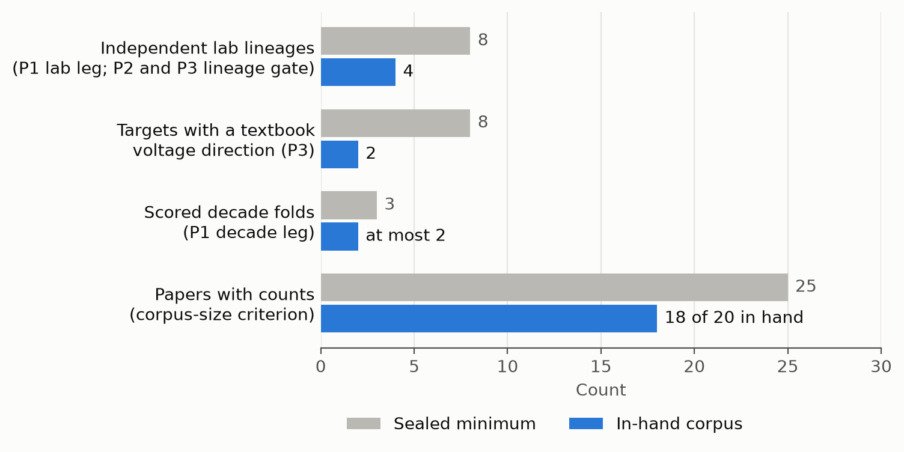
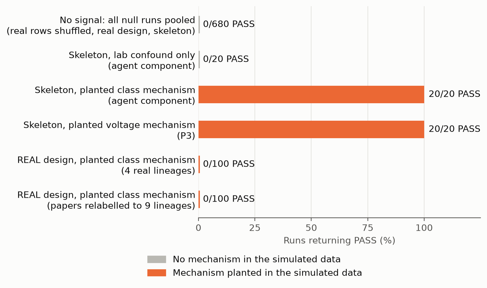
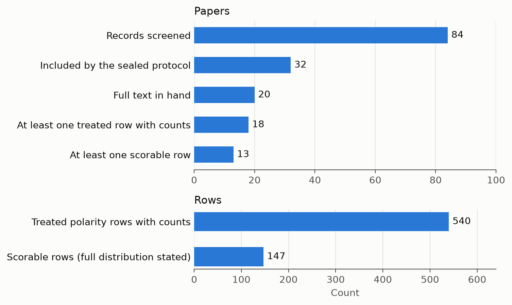

> **DRAFT — not submitted; for author review**

# The published planarian bioelectric literature cannot yet test whether bioelectric state predicts anatomical outcome across labs and decades

**Manav Davis**

Affiliation: [to fill]

Draft date: 2026-11-10. Repository: https://github.com/MDavis3/bioelectric-bench

---

## Abstract

A central claim of developmental bioelectricity is that bioelectric state, for example the direction in which an ion-channel or pump perturbation moves membrane voltage, carries information about anatomical outcome that generalises beyond the experiment in which it was found. Planarian regeneration is the system in which this claim is most often illustrated. We asked whether the published planarian literature can test it. We fixed a corpus protocol, an extraction schema, three endpoints and a verdict rule, sealed each by hash in a public git repository before the data they govern existed, and kept the analyst blind to outcomes. No real outcome was scored. From setup information alone, the in-hand corpus (20 of 32 included papers) falls below every sealed minimum: 4 independent lab lineages against 8 required, 2 targets with an assignable voltage direction against 8, and at most 2 scorable decade folds against 3. In calibration, the judge returned no false pass in 680 null runs and passed planted mechanisms on a synthetic 9-lineage corpus, but on the real experimental design a strong planted mechanism passed 0 of 200 times. Extraction found treated rows with counts in 18 of 20 papers (540 rows), but only 147 rows from 13 papers are scorable, because most papers do not report what the remaining animals in an arm did. A re-pilot against the Planform database passed its category, coverage and frequency gates; its source-spreadsheet gate was ill-defined and failed. The sealed corpus-size rule ended in its stop-and-report branch, so the formal "untestable by corpus size" call is open until corpus closure. The endpoint-level result does not depend on it: this literature cannot currently confirm or refute the claim, and a failed test on it would not be evidence against a bioelectric code. We list the reporting changes that would make the claim testable.

---

## 1. Introduction

Work over two decades has argued that endogenous bioelectric signals (resting membrane potential, ion flows, and gap-junctional coupling) act as instructive cues in pattern formation, and that these signals form a code that can be read and rewritten (Levin 2014; Levin and Martyniuk 2018; Levin 2021). Planarian regeneration supplies many of the best-known examples. Blocking gap junctions changes anterior-posterior polarity in regenerating fragments (Nogi and Levin 2005; Oviedo et al. 2010). Inhibiting the H,K-ATPase alters membrane voltage and head regeneration (Beane et al. 2011; Beane et al. 2013). Brief perturbations can produce lasting changes in the anatomy to which fragments regenerate (Durant et al. 2017), and early voltage patterns have been linked to later polarity (Durant et al. 2019). Related lines of work include praziquantel and voltage-operated calcium channels (Nogi et al. 2009; Zhang et al. 2011 [ref check]) and a much older literature on anesthetics, metabolic inhibitors and applied electric fields (Child 1911 [ref check]; Buchanan 1922 [ref check]; Rustia 1925 [ref check]; Marsh and Beams 1952 [ref check]).

Individual experiments show that a given perturbation changes anatomy in a given lab. The stronger claim, and the one that the word "code" implies, is general: knowing the bioelectric character of a perturbation should help predict the anatomical outcome of an experiment that was not used to form the rule, done by a different group, with a different agent or target, or in a different decade. That claim is about the literature as a whole, so it can in principle be tested on the literature as a whole: extract every reported arm, hold out papers by lab, agent, target or decade, and ask whether a model that knows the mechanistic features predicts held-out outcome distributions better than a model that knows only who did the experiment and when.

Such a test is useful only if its outcome could go either way. Before running one, we therefore asked a prior question: does the published planarian record contain enough independent, fully reported experiments for a preregistered test of this kind to be able to pass if the claim were true? This paper reports the answer. It is a testability result: it contains no effect estimate and does not bear on whether a bioelectric code exists.

## 2. Methods

### 2.1 Overview and roles

Literature screening, data extraction, adjudication and code review were carried out by large-language-model agents (Claude Sonnet 5.5, Opus 5.5 and Fable 5.2, Anthropic) under written instructions, orchestrated by a planning agent and supervised by the author. No human-extracted gold set exists (see Limitations).

### 2.2 Corpus and closure rule

The corpus protocol (`sealed/corpus_protocol__a87404a267ba.md`) fixes the search strings (PubMed and Europe PMC, run 2026-11-09, plus supplementary queries for pre-1990 records and the publication list of the Planform database; Lobo et al. 2013), and the inclusion criteria: primary research; a planarian; an amputation or injury regeneration assay; an electrical or ionic intervention (drugs acting on channels, pumps or gap junctions, ionophores, applied fields, ion substitution, or RNAi of channels, pumps or innexins); and an anterior-posterior polarity outcome. Any year and language were eligible. Screening covered 84 records; after an independent citation-chasing check, 32 were included and the manifest was sealed.

Full text was in hand for 20 of the 32. Of the 12 not in hand, 9 could still add counts (Rulon 1944; Marsh and Beams 1952; Dimmitt and Marsh 1952; Bonaventure 1957; Marsh 1962; Liotti 1966; Marsh 1969; Rose 1970; Ferenc 2019 [ref check, all nine]) and 3 cannot (one 1947 abstract and two unidentified records).

A closure rule (`corpus_closure_v1`) fixes 2026-12-01 00:00 UTC as the date after which newly arrived papers go to a separate analysis and cannot change this one. A paper counts as arrived only when a log line with its path, size and hash has been pushed before that time.

### 2.3 Extraction

Each paper was extracted to a fixed schema with one row per experimental arm: organism, fragment, intervention (agent, target, action, dose, timing), arm role, and an outcome distribution over seven sealed categories for the primary family (normal, double head, double tail, headless, tailless, no regeneration, other). Control and vehicle arms were extracted as well as treated arms.

Three kinds of pass were used.

- **Setup-only pass.** Agents recorded the design of every arm and no results. This pass covered 28 papers and 774 arms across all task families, and supports the testability counts in section 3.1.
- **Two blind outcome passes.** Two different models extracted full rows independently, each blind to the other.
- **Adjudication.** A third model resolved disagreements, blind to which pass produced which row (passes were relabelled X and Y by a script with a coin flip per paper).

Extraction rules were frozen before any second-version row existed. A **remainder rule** governs incompletely reported arms: if a paper states what the animals outside the reported category did, that is coded; if it does not, the row is flagged partial and is never scored. A row is **scorable** if it is a treated primary-family row whose full outcome distribution is stated and which is not a low-confidence figure read.

Two derived labels were assigned from setup strings by sealed lookups, never by an extractor. **Lab lineage** groups a lab with the people it trained (`lab_lineage_v3`). The **voltage-direction label** assigns "depolarize", "hyperpolarize" or no direction to an arm from its target class and action using textbook electrophysiology (`vmem_rule`, `vmem_lookup_v3`). It is a pharmacological expectation, not a measurement.

### 2.4 Firewall

The analyst (the planning agent, and the author through it) was not to see any outcome before the analysis using it was sealed. From the second harness version this was enforced by storage layout and scripts (`FIREWALL.md`): full rows, outcome files, comparison output and the papers themselves live under denied paths; setup fields are split from outcome fields at write time; every agent that reads papers or outcomes replies with a single JSON object whose values are integers and whose keys come from a fixed schema; and a check script scans every analyst-readable file for outcome structures before each commit. The denial is not enforced by operating-system permissions.

This manuscript was drafted from aggregate reports only.

### 2.5 Sealing

A file is sealed by hashing it, copying it to `sealed/` under a name containing the hash, recording it in `sealed/SEALS.json`, and committing and pushing, so that the public remote holds a timestamp the analyst does not control. A name can be sealed once; corrections are sealed under a new name. The registry holds 29 seals, all dated 2026-11-10 UTC. They cover the corpus protocol and manifest, schema, outcome categories, analysis plan, holdout parameters, harness manifest, lineage and voltage lookups, re-pilot gates, bound rule and closure rule. This is preregistration by timestamped commit; nothing was lodged with an external registry.

### 2.6 Endpoints and judge

All endpoints concern the planarian anterior-posterior polarity family. Models have no pretraining and are fitted only on training folds. The primary learner is a tempered naive Bayes on the sealed setup features with the majority distribution as prior; the temperature is chosen by paper-level cross-validation inside each training fold. It is compared with a majority model and with a covariate model that uses only year bucket, lineage, organism and intervention type. Predictions are scored by Brier score on held-out outcome distributions, with every row of a held-out unit's papers removed from training.

- **P1 (new decades and new labs).** The learner beats both comparators in rolling-decade holdout and in leave-one-lineage-out holdout.
- **P2 (unseen agents and unseen targets).** The same in leave-one-agent-out and leave-one-target-out holdouts, each also requiring a lineage-resampled confidence interval below zero.
- **P3 (does the voltage label add anything).** In target holdout, on direction-carrying rows only, a model with the voltage label beats the same model without it, with a lineage interval below zero, a label-permutation p below 0.05, and a check that a model given target class instead does not do materially better.

The verdict rule tests failure first. A comparison is UNTESTABLE below 3 scored folds or 8 clusters, and lineage-gated endpoints are UNTESTABLE below 8 lineages; P3 needs 8 direction-carrying targets. It is FAIL if any interval rules out a Brier gain of 0.02 (the smallest effect of interest), PASS if every interval lies below zero and a sign-flip test gives p below 0.05, and INCONCLUSIVE otherwise. Intervals use 5,000 bootstrap resamples and the permutation test 200 permutations. A counted run is guarded by a write-once marker and refuses to start unless every seal is pushed and the code matches the sealed manifest. No counted run has been made.

Two kill criteria were sealed with the plan: fewer than 25 primary-family papers with counts means the endpoints are declared untestable from published data; and the voltage rule must assign a direction to more than half of treated arms for P3 to be testable.

### 2.7 Bound rule

Because 12 papers were not in hand, a bound rule (`bound_rule_v1`) was sealed before any second-version row existed. It counts in-hand papers with at least one treated primary-family row with a count above zero, deliberately generously (partial rows and figure reads count). If the count is 15 or fewer, the 25-paper criterion cannot be met even if all 9 obtainable papers have counts, and the endpoints are declared untestable. If it is 16 or more, the rule says to stop and report, because the missing papers decide.

### 2.8 Calibration

The sealed analysis code was run on simulated outcomes to measure how often it passes when nothing is there and when something is (`harness/calibrate_v2.py`). Three inputs were used: a synthetic skeleton of 24 papers in 9 lineages; the real design, meaning the setup columns of the 302 treated primary-family arms from the setup-only pass, with outcomes simulated; and the real adjudicated rows with their outcomes shuffled, run by a separate agent that returned verdict tallies only. Simulated worlds were: no signal; outcome set by target class and action; outcome set by the voltage label; a lab confound with no mechanism; one dominant lab carrying all the signal; and too few directional targets.

Synthetic runs used 50 permutations rather than the sealed 200, for runtime; the real-outcome shuffles used the sealed parameters unchanged. A rerun of the synthetic worlds at 200 permutations was started on 2026-11-10 and had not finished when this draft was written (`reports/calibration_n200/` has no completion flag). All calibration numbers below are from the 50-permutation run.

### 2.9 Re-pilot gates

Before the corpus extraction, the pipeline was tested on six papers against outside references, under gates sealed in advance (`repilot_gates_v1`). Five papers are covered by Planform, a human-curated database of planarian experiments; the sixth has a source-data spreadsheet. G1: among matched experiments, the adjudicated row's largest category equals Planform's (threshold 0.80). G2: share of Planform's in-scope experiments matched by a row (0.60). G3: the largest category's frequency within 0.15 of Planform's (0.80, secondary). G4: for the spreadsheet paper, share of sheet arms matched (0.80) and share of matched rows exact (0.90). G5: row recall between the two passes (0.80 desired, not gating). G1, G2 and G4 all had to pass.

## 3. Results

### 3.1 Testability from setup counts

From setup information alone, the in-hand planarian polarity corpus falls short of each sealed minimum (Table 1, Figure 1).

**Table 1. Sealed minimums and what the in-hand corpus provides.** Source: `reports/testability_v2.md`, `reports/setup_counts_v3lookup.md`, `reports/findings_v2.md`.

| Quantity | In hand | Sealed minimum | Endpoint affected |
|---|---|---|---|
| Independent lab lineages | 4 | 8 | P1 lab leg; P2 and P3 lineage gate |
| Targets carrying a voltage direction | 2 (5 of 302 treated arms) | 8 | P3 |
| Scored decade folds | at most 2 | 3 | P1 decade leg |
| Papers with a treated arm (setup pass) | 15 | — | — |
| Papers with counts (formal count, section 3.5) | 18 | 25 | corpus-size criterion |
| Treated arms / distinct agents / distinct targets | 302 / 108 / 80 | 8 held-out units | P2 (met) |

**Figure 1. Sealed minimums against the in-hand corpus.** Grey: the minimum fixed in the sealed parameters or plan. Blue: the count in the 20 in-hand papers.

The four lineages are the Levin, Marchant, Child-school and McCaig/Aberdeen groups. The consequences under the sealed rules are:

- **P1 is untestable.** Only four in-hand papers predate 2010, so most decade origins have fewer than five training papers and are skipped; and there are 4 lineages against 8.
- **P2 cannot pass.** There are enough held-out agents and targets, but the lineage-resampled interval that a pass requires does not exist below 8 lineages. P2 can still return FAIL.
- **P3 is untestable.** Two targets carry a direction. The agents that dominate planarian work (H,K-ATPase inhibitors, gap-junction blockers, praziquantel, ivermectin, calcium-channel drugs, anesthetics) receive no direction under a textbook rule. On our reading of the plan, the second kill criterion is also met, since 5 of 302 treated arms carry a direction.

Overlap between groups is small: 8 of 108 agents and 8 of 80 targets were tested by more than one lineage.

### 3.2 Calibration and power

**The judge does not pass when nothing is there.** Across 680 null runs there were no passes (Table 2).

**Table 2. Null runs.** Source: `reports/calibration_v2.md`.

| Data | Runs | PASS | Other verdicts |
|---|---|---|---|
| Real adjudicated rows, outcomes shuffled, agent holdout | 200 | 0 | 199 FAIL, 1 UNTESTABLE |
| Real adjudicated rows, outcomes shuffled, target holdout | 200 | 0 | 197 FAIL, 3 UNTESTABLE; P3 UNTESTABLE 200/200 |
| Real design (302 arms), no-signal world, real and 9-lineage variants | 200 | 0 | 200 FAIL |
| Synthetic skeleton, no-signal world, four holdout modes | 80 | 0 | 60 FAIL, 20 UNTESTABLE (decade) |
| **Total** | **680** | **0** | |

**The judge passes when a mechanism is planted in an adequate design.** On the synthetic 9-lineage skeleton (20 seeds per world), a planted class mechanism passed the agent, target and lab components 20 of 20 times each, and P3 correctly never passed, because the signal was class and not voltage. A planted voltage mechanism passed all three components and P3 20 of 20 times. A lab confound with no mechanism failed 20 of 20 in every component. With one dominant lab the lineage gate blocked a pass that the unit-level test alone would have given in 19 of 20 seeds. With four directional targets P3 was UNTESTABLE 20 of 20. Decade holdout was untestable on the skeleton, so P1 as a conjunction was not exercised.

**On the real design, a planted mechanism does not pass.** Placing a strong class signal (strength 0.4) on the real 302-arm design gave 0 passes in 100 runs with the 4 real lineages and 0 in 100 runs with the papers relabelled into 9 synthetic lineages (Table 3, Figure 2). With the lineage gate switched off, the unit-level test passed in 2 of 100 runs in each variant.

**Table 3. Power on the real design.** Source: `reports/calibration_v2.md`.

| World | Lineage variant | Runs | PASS | Unit-level PASS (lineage gate off) |
|---|---|---|---|---|
| Class mechanism, strength 0.4 | 4 real lineages | 100 | 0 | 2 |
| Class mechanism, strength 0.4 | 9 synthetic lineages | 100 | 0 | 2 |
| No signal | both | 200 | 0 | 0 |

**Figure 2. Calibration pass rates.** Grey: simulated data with no mechanism. Orange: simulated data with a planted mechanism. Synthetic runs used 50 permutations; a 200-permutation rerun is in progress.

The planted-signal and no-signal cases are therefore almost indistinguishable on the real design: the interpretation report gives 196 FAIL in the 200 planted runs and 396 FAIL in 400 null runs on real-corpus inputs. The relabelling result shows that the lineage count is not the only obstacle. Each class of agent sits almost entirely inside one or two papers from one group, and a holdout that removes a unit's papers from training leaves nothing from which to transfer.

### 3.3 Extraction yield

All 20 in-hand papers were extracted and adjudicated. Eighteen have at least one treated polarity row with counts, 540 such rows in total; two have none (Figure 3). The rows are unevenly spread: one paper contributes 206 of the 540, and five papers contribute one or two rows each.

Only 147 of the 540 rows (27%), from 13 papers, are scorable. The main reason is the remainder rule: a paper reports the frequency of the phenotype of interest and does not say what the other animals in the arm did, so the outcome distribution is incomplete. The loss is uneven; one lineage has 121 treated arms in the setup pass and 3 scorable rows. The scorable rows span 17 agents and 8 targets in 4 lineages.

**Figure 3. From records to scorable rows.** Counts of papers (top) and of treated polarity rows (bottom) at each stage.

### 3.4 Re-pilot against Planform

**Table 4. Re-pilot gates.** Source: `reports/repilot_gates_result.json`, `reports/repilot_g4_diagnosis.json`.

| Gate | Result | Threshold | Outcome |
|---|---|---|---|
| G1 main category agrees | 79/79 = 1.00 | 0.80 | pass |
| G2 coverage of Planform in-scope experiments | 147/180 = 0.82 | 0.60 | pass |
| G3 frequency within 0.15 | 76/79 = 0.96 | 0.80 | pass |
| G4 source spreadsheet arms matched | 0/20 | 0.80 | fail |
| G5 inter-pass row recall | 135/257 = 0.53; 135/215 = 0.63 | 0.80 desired | not gating |

Coverage was 0.23 in an earlier pilot with the first-version instructions. G1 and G3 cover the easier rows: 68 of the 147 matched rows were partial and were excluded from those two gates as the sealed rule specifies. (The 147 matched rows here and the 147 scorable rows in section 3.3 are different sets; the equal counts are a coincidence.)

G4 failed as sealed. The diagnosis is a defect in the gate, not a measured transcription error: the named spreadsheet held 20 arms, none of which is an in-scope arm of the primary family, so no match was possible and no check of count transcription took place. Under the sealed consequence, the re-pilot failed overall, the corpus rows are flagged, and they cannot enter a counted run until a new re-pilot passes. We did not change the gate after seeing the result.

### 3.5 Bound rule

The sealed count is 18 of 20 in-hand papers with counts. That is 16 or more, so the rule's outcome is **stop and report**: the corpus-size criterion is neither triggered nor cleared, and the 9 obtainable papers decide it. Reaching 25 would need 7 of the 9 to arrive before closure with counts.

Three qualifications apply. First, the count is generous by design; it includes partial rows and figure reads, and one paper is flagged in the count file as counted under the rule's problem clause. Second, the setup-only pass had implied at most 15, and was wrong; the formal count went the other way. Third, the definition for the final 25-paper test must be sealed before any missing paper is extracted, and that choice now determines the verdict: counting as above gives at most 27, while counting only papers with scorable rows gives at most 22. That choice is no longer blind and is reported as such.

The endpoint results in sections 3.1 and 3.2 do not depend on this call. The titles of the missing papers name applied fields, alcohol, lithium and ivermectin, none of which receives a voltage direction under the sealed rule, so P3 stays untestable whatever arrives; and the estimated lineage total with all of them is 6 to 7, still below 8.

## 4. Discussion

### 4.1 What the result is

Under endpoints and minimums fixed in advance, the in-hand planarian record cannot return a positive answer on whether bioelectric features predict anatomical outcome across labs, agents, targets or decades, and in simulation it returns FAIL at nearly the same rate whether or not a mechanism is present. A failed test on this corpus would carry no information, and we have not run one. The finding concerns the shape of the evidence base: a few groups, each working mostly on its own agents, reporting mostly the frequency of one phenotype.

### 4.2 What would make the claim testable

1. **Report the full outcome distribution for every arm.** For each arm, including controls, give the number of animals scored and the count in every outcome category, including normal, dead and unscorable. This single change would have made most of the 540 rows scorable instead of 147. A supplementary table is enough. It is consistent with existing animal-research reporting guidance (Percie du Sert et al. 2020).
2. **Independent groups testing the same agents and targets.** The binding constraint is overlap, not volume. Eight or more independent lineages, with the same classes of agent tested in several of them, is what the lineage gate and the transfer test need. Deliberate cross-lab replication of a small shared panel would do more than many new single-lab agents.
3. **Measure voltage.** A textbook rule assigns a direction to 2 of 80 targets in this corpus. A claim about voltage direction needs the direction to be measured in the treated tissue (dye or electrode), with sign, region and time, and reported per arm, so that the feature does not rest on pharmacological expectation.
4. **Report the design in machine-readable form.** Species and strain, fragment and amputation plane, agent, dose with units, exposure window, scoring day and scoring scheme, per arm.
5. **Deposit source data.** Per-animal or per-arm spreadsheets remove figure reading from the pipeline.

### 4.3 Limitations

- **No counted run and no human gold set.** Extraction and adjudication were done by language models. The only outside check is Planform, for five papers, on the easier rows. Inter-pass row recall was 0.53 and 0.63 against a desired 0.80. The count-based results (lineages, targets, folds) are robust to this; the row counts are less so.
- **The re-pilot failed as sealed.** G4 was ill-defined, which is our error in writing the gate. Count transcription has not been checked against source data.
- **Outcome exposure of the analyst.** Several crossings are logged. Adjudicator summaries in the first session contained a few outcome fragments for pilot papers. A supplement for one paper (Beane et al. 2011) was attached to the planning context by the application. Notes from a web search contained qualitative result statements for Emmons-Bell et al. 2015 and a phenotype word for Nogi and Levin 2005. These papers are treated as analyst-exposed. The firewall also caught 109 setup rows carrying result words, which were quarantined unread; this shows that extractors still leak.
- **Procedural slips.** The planning agent once ran the blinding script over restricted rows (it printed a count only). The setup-pass upper bound of 15 was known about two minutes before the bound rule was sealed; the threshold and wording predate it. Endpoint-affecting changes in the second harness version (the 8-lineage minimum, the sign-flip requirement, skipping small folds) were logged and made before any second-version row existed, but after first-session outcomes had leaked. About 70 probe requests reached a publisher's server before its robots.txt, which disallows them, was read; nothing was downloaded.
- **Firewall strength.** It is enforced by layout, scripts and integer-only replies, not by operating-system permissions.
- **Harness review.** Two independent code reviews each ended "seal after must-fixes"; the last four fixes were not re-reviewed, and the harness was sealed before calibration finished.
- **Calibration scope.** Synthetic runs used 50 permutations instead of 200. Power on the real design used one planted signal type and one strength, on the 302 setup-pass arms; the 147 scorable rows are a thinner design, and power with the missing papers added was not simulated.
- **Open data problems.** The adjudicated rows have 31 validation problems, 12 agent names not in the sealed lookup, and one lineage label absent from the sealed map; these would block a counted run. The corpus status file already marks the 12 missing papers unreachable, ahead of closure.
- **Scope.** One organism group and one outcome family, one search run, a pharmacological voltage label, and a lineage map that involves judgment. Different endpoints or minimums would give different testability thresholds; ours were fixed before the counts were known, with the exceptions stated above.
- **Corpus completeness.** Twelve of 32 included papers are not in hand, most from before 1971.

## 5. Data and code availability

All code, plans, sealed files and aggregate reports are in the public repository https://github.com/MDavis3/bioelectric-bench. The seal registry is `sealed/SEALS.json`; each entry gives the file hash, the commit and the UTC time. The public derived data are the setup-only tables under `data/setups/**` (experimental design per arm, no outcomes) and the sealed files under `sealed/**` (corpus protocol and manifest, schema, outcome categories, lookups, parameters, rules). Aggregate results cited here are in `reports/` (`testability_v2.md`, `calibration_v2.md`, `bound_count_v1.json`, `repilot_gates_result.json`, `repilot_g4_diagnosis.json`, `findings_v2.md`). Figures are produced by `drafts/preprint_planarian/make_figs.py` from the numbers in those reports. Copyrighted article PDFs and supplements are not redistributed. [Author to confirm before release: which outcome-level files, if any, are public, and that the repository history contains no restricted material.]

## 6. Next

A natural follow-up is to ask the same kind of question where independent groups and shared targets are plentiful: cross-species phenotype databases that record, for many genes and many labs, the anatomical consequences of perturbing ion channels, pumps and gap-junction genes. Draft plans for a test of whether gene class predicts anatomical outcome across species are in the repository (`plans/pivot_db_v0.md` and later drafts); nothing is sealed. Its first step would be the one used here: establish from design information alone, before any outcome is read, whether the test could pass. No results from that work exist.

## Acknowledgements

[to fill]

## Competing interests

[to fill]

## References

Entries marked [ref check] need bibliographic details verified against the source before submission; the rest should also be checked.

1. Beane WS, Morokuma J, Adams DS, Levin M (2011). A chemical genetics approach reveals H,K-ATPase-mediated membrane voltage is required for planarian head regeneration. *Chemistry & Biology* 18:77–89.
2. Beane WS, Morokuma J, Lemire JM, Levin M (2013). Bioelectric signaling regulates head and organ size during planarian regeneration. *Development* 140:313–322.
3. Buchanan JW (1922). *Journal of Experimental Zoology*. [ref check: title, volume, pages]
4. Child CM (1911). *Journal of Experimental Zoology*. [ref check: title, volume, pages]
5. Durant F, Morokuma J, Fields C, Williams K, Adams DS, Levin M (2017). Long-term, stochastic editing of regenerative anatomy via targeting endogenous bioelectric gradients. *Biophysical Journal* 112:2231–2243.
6. Durant F, Bischof J, Fields C, Morokuma J, LaPalme J, Hoi A, Levin M (2019). The role of early bioelectric signals in the regeneration of planarian anterior/posterior polarity. *Biophysical Journal* 116:948–961.
7. Emmons-Bell M, Durant F, Hammelman J, et al. (2015). Gap junctional blockade stochastically induces different species-specific head anatomies in genetically wild-type *Girardia dorotocephala* flatworms. *International Journal of Molecular Sciences* 16:27865–27896.
8. Levin M (2014). Molecular bioelectricity: how endogenous voltage potentials control cell behavior and instruct pattern regulation in vivo. *Molecular Biology of the Cell* 25:3835–3850.
9. Levin M (2021). Bioelectric signaling: reprogrammable circuits underlying embryogenesis, regeneration, and cancer. *Cell* 184:1971–1989.
10. Levin M, Martyniuk CJ (2018). The bioelectric code: an ancient computational medium for dynamic control of growth and form. *BioSystems* 164:76–93.
11. Lobo D, Malone TJ, Levin M (2013). Planform: an application and database of graph-encoded planarian regenerative experiments. *Bioinformatics* 29:1098–1100.
12. Marsh G, Beams HW (1952). Electrical control of morphogenesis in regenerating *Dugesia tigrina*. I. Relation of axial polarity to field strength. *Journal of Cellular and Comparative Physiology* 39:191–213. [ref check]
13. Nogi T, Levin M (2005). Characterization of innexin gene expression and functional roles of gap-junctional communication in planarian regeneration. *Developmental Biology* 287:314–335.
14. Nogi T, Zhang D, Chan JD, Marchant JS (2009). A novel biological activity of praziquantel requiring voltage-operated Ca2+ channel beta subunits: subversion of flatworm regenerative polarity. *PLoS Neglected Tropical Diseases* 3:e464.
15. Oviedo NJ, Morokuma J, Walentek P, et al. (2010). Long-range neural and gap junction protein-mediated cues control polarity during planarian regeneration. *Developmental Biology* 339:188–199.
16. Percie du Sert N, Hurst V, Ahluwalia A, et al. (2020). The ARRIVE guidelines 2.0: updated guidelines for reporting animal research. *PLoS Biology* 18:e3000410.
17. Rustia CP (1925). *Journal of Experimental Zoology*. [ref check: title, volume, pages]
18. Zhang D, Chan JD, Nogi T, Marchant JS (2011). *Journal of Neuroscience*. [ref check: title, volume, pages]
19. The nine not-in-hand papers named in section 2.2 (Rulon 1944; Marsh and Beams 1952; Dimmitt and Marsh 1952; Bonaventure 1957; Marsh 1962; Liotti 1966; Marsh 1969; Rose 1970; Ferenc 2019): full details to be taken from `sealed/corpus_manifest__cd456381710a.csv`. [ref check]
